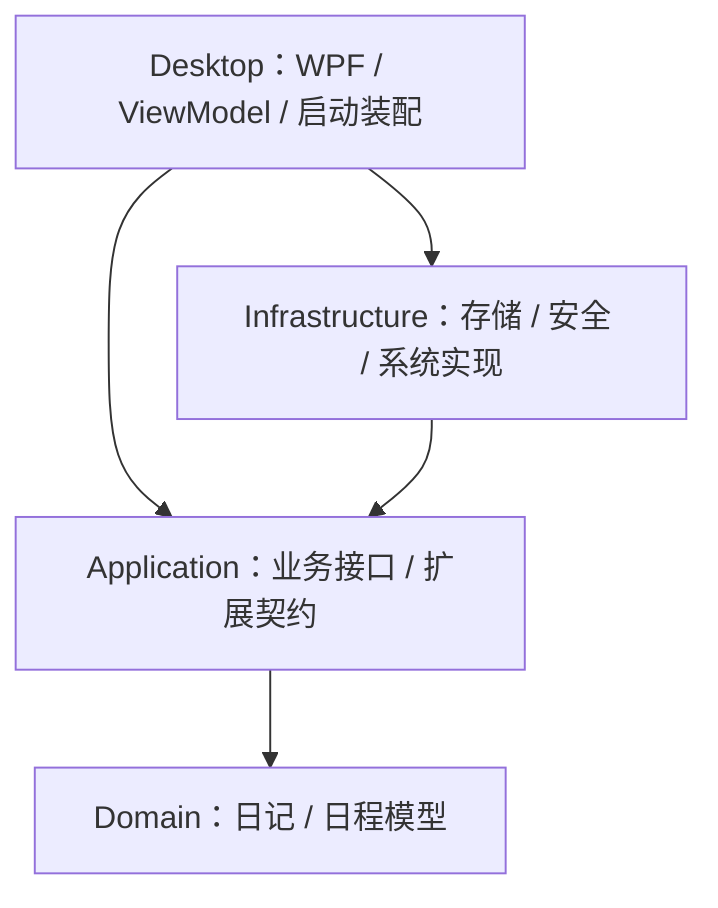

# 架构与开发边界

状态：主要桌面功能已经实现，当前源码版本为 1.1.1；发布物已生成，仍待项目所有者完成最终运行验收。

## 选型

界面使用 XAML + WPF；界面状态、业务逻辑、系统功能使用 C#。WPF 只支持 Windows，符合本项目的平台范围。[WPF 官方说明](https://learn.microsoft.com/en-us/dotnet/desktop/wpf/overview/)

当前目标为 .NET 9，与开发机已有的 SDK 和 Visual Studio 2022 环境一致。.NET 9 官方支持至 2026 年 11 月 10 日，因此必须在停止支持前安排升级，避免私人数据应用继续运行在不再接收安全修复的运行时上。[.NET 支持政策](https://dotnet.microsoft.com/en-us/platform/support/policy)

选择依据是 Windows 集成、维护成本和避免 WebView 常驻进程的需求；这是架构判断，不是已测得的内存对比。安装包大小与运行内存要分别衡量，不承诺固定 MB 数值。

## 分层与依赖

Desktop 仅在启动装配处选择基础设施实现。ViewModel 通过业务接口工作，不能自行操作业务数据文件。Domain 不依赖界面、Windows API 或存储驱动。

第一阶段采用手动构造依赖；当对象数量增加时再评估依赖注入容器。避免为了目录形式引入后台 Web 服务、大型框架或大量空项目。

## 当前能力与边界

| 已实现 | 当前边界或后续方向 |
| --- | --- |
| 六周月历、分钟级单日时间轴、Class/Key/Idea 和 Task 批量排布 | 月历与单日详情保持各自独立的撤销/重做语义 |
| 图文日记、搜索、日记与日程跳转 | 图片以内嵌 Base64 保存，数据文件可能快速增大 |
| 工作目标、录制、中断、跨午夜和统计 | 单次录制最长 24 小时 |
| 提醒、托盘、悬浮窗、热键、开机自启和单实例 | 独占全屏、反作弊软件或更高权限进程可能限制置顶行为 |
| 自定义安装、原地升级、卸载和 Windows 注册 | 卸载默认保留用户数据；发布物仍需所有者验收 |
| 可移植 JSON 和旧 DPAPI 日程迁移 | 当前数据不是加密保险库；加密或数据库化必须作为独立迁移项目 |

## 主窗口导航框架

主窗口采用左侧导航栏与右侧内容面板。导航按钮由 `NavigationRegistry` 注册结果生成，XAML 不直接列出具体功能，因此增加页面时不需要修改主窗口结构。常用功能注册到 `Main` 区域并从上向下排列；设置等辅助入口注册到 `Footer` 区域。

每个页面通过工厂延迟创建，并在首次打开后保留状态。应用退出时 `ShellViewModel` 会释放已创建且实现 `IDisposable` 的页面对象。注册表拒绝空标识和重复标识，页面工厂返回空值时立即失败，避免导航进入不完整状态。

当前主页面包括日程表、日记、工作模式和设置。日程编辑、单日详情、日记编辑、工作目标及中断编辑使用独立窗口；跨页面联动和窗口唯一性由组合根协调。

当前日程、日记和工作记录保存为设置指定缓存目录中的可移植明文 JSON。Portable 仓储采用进程内串行化及“同目录临时文件 + 落盘刷新 + 替换/移动”提交。旧 `userdata\vault\calendar.dat` 仅作为 Windows DPAPI 日程迁移源；迁移结果仍是明文 JSON。

单实例作用域为当前 Windows 会话；Debug 和 Release 使用不同名称，方便开发预览。当前重复启动仅提示用户从托盘打开。

## 内存与后台行为

- 不启动本地 HTTP 服务、不使用浏览器渲染界面、不启动额外工作进程。
- 只加载当前日期或当前页，不把所有日记和附件常驻内存。
- 提醒使用下一次到期时间驱动，修改日程后重排；避免固定每秒查库。
- 隐藏窗口后停止动画和无用刷新，后续锁定时释放敏感视图与缓存。
- 存储和附件处理通过业务服务与仓储执行，避免界面代码直接修改数据文件。
- 当前托盘引用 Windows Forms 的 NotifyIcon，会有相应程序集开销；先用系统维护的 API，是否替换为 Win32 由实际测量决定。
- 不通过强制 GC 或清空工作集伪装低内存。后续由用户分别观察 Release 打开窗口、托盘常驻、长期使用三种状态。

## 私密数据的安全设计

安全目标是减少误上传、日志泄漏和跨环境数据混用。当前数据没有静态加密，不能承诺防止能够读取相应 Windows 文件的程序或账户访问内容。

1. 默认离线；不加入遥测、远程字体、自动上传、自动同步或远程内容渲染。
2. 生产数据放在 `%LOCALAPPDATA%\DiaryOfMine\userdata`，Debug 放在 `%LOCALAPPDATA%\DiaryOfMine.Dev\userdata`。源码和安装目录不应包含日记、缓存、日志、密钥、数据库或备份。
3. 日程、日记和工作记录当前是明文 JSON。能够读取这些文件的程序或账户也可能读取私人内容，不应把本应用描述为已实现保险库或应用密码保护。
4. 未来若引入加密、数据库或可迁移备份，必须提供明确的 schema、迁移、失败恢复和旧版本拒绝策略，不能静默回退或覆盖未知版本数据。
5. 提醒内容和窗口锁定策略需要按隐私影响单独评估；窗口隐藏不等同于数据加密或安全锁定。
6. 日志只记录错误类别、操作与匿名标识，不记录正文、标题、用户路径、密码、密钥、连接字符串或异常消息。调试使用虚构数据。
7. 模块仅显式注册受信任的内置代码，不扫描文件夹自动执行 DLL。进程内接口不是权限沙箱，第三方插件需要另行设计隔离与授权。

`userdata/appsettings.json` 保存缓存路径、日志路径和窗口行为，不保存日记正文或凭据。设置采用临时文件写入后替换正式文件；若 JSON 损坏，应用停止加载并保留原文件，不覆盖为默认值。缓存与日志目录必须是绝对路径且当前用户具有创建权限。

应用日志记录固定的生命周期和关键操作事件名，不接受正文、标题、路径、异常消息或任意用户内容。每项操作以同一编号生成“输入”和“输出”记录，异常输出只包含异常类型、HRESULT 和发生方法。日志按本地日期存入 `日志根目录\YYYY-MM-DD\DiaryOfMine.txt`；更改目录后，新日志写入新位置，写入失败不会回退到其他目录。详细格式见 `docs/logging.md`。

## 最小化、托盘与悬浮

启用“主窗口消失或切换到软件外时自动进入悬浮休眠”后，以下入口统一进入悬浮模式：主窗口确认切换到其他应用、主窗口最小化、主窗口关闭、主窗口 Esc 和 `--startup` 开机自启。编辑器、详情窗和工作编辑窗属于自动悬浮保护窗口；它们存在时切换到资源管理器或打开同进程文件弹窗不会隐藏窗口，误触主窗口最小化或关闭也会恢复并重新激活编辑窗口。关闭该设置后，主窗口最小化保留任务栏入口，关闭按钮隐藏到托盘且进程继续运行；Esc 和 `--startup` 仍是明确的悬浮入口。点击悬浮窗或托盘入口会恢复此前隐藏的主窗口与伴随窗口，并恢复活动状态。

固定悬浮窗时会保存屏幕坐标并启用 WPF `Topmost`。它可以覆盖普通窗口和多数无边框全屏程序，但 Windows 的独占全屏、游戏反作弊策略或更高权限程序可能阻止显示，因此不能承诺覆盖所有游戏。

悬浮和窗口保护是交互能力，不构成保险库、访问控制或静态数据加密。

## 扩展位置

`Application/Modules/IDiaryModule.cs` 定义描述信息、初始化和异步释放。新业务优先在 Application 增加用例与接口，在 Infrastructure 实现，在 Desktop 添加独立视图并于启动处装配。模块不直接读取其他模块的数据文件。

预留方向：标签与搜索、日历、重复日程、加密备份、导出、附件、主题。云同步和第三方代码执行不属于当前范围。

后续优先事项包括完成开源发布准备、建立基本 CI、安排 .NET 运行时升级，以及把加密备份或数据库化作为独立迁移项目评估。每项发布仍由项目所有者完成最终运行验收。
